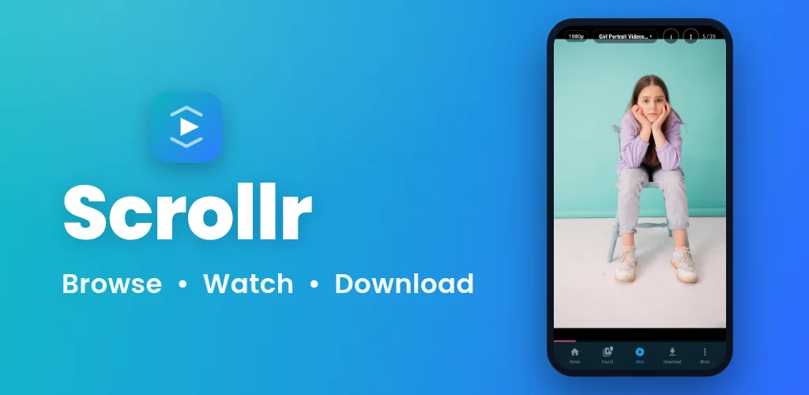
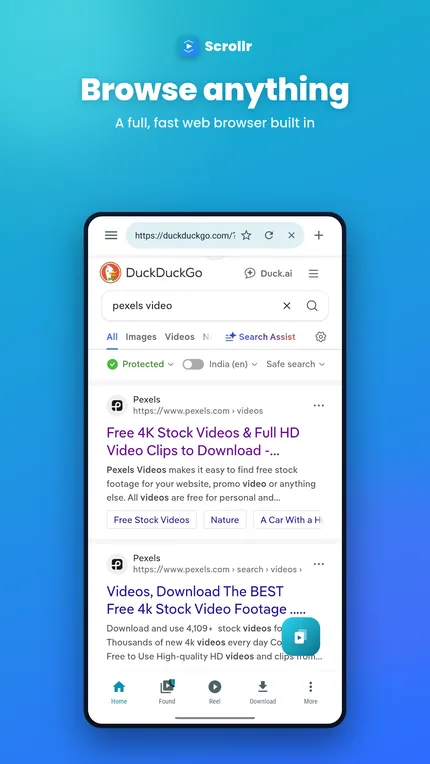
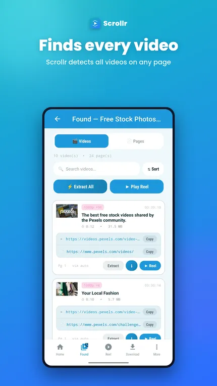
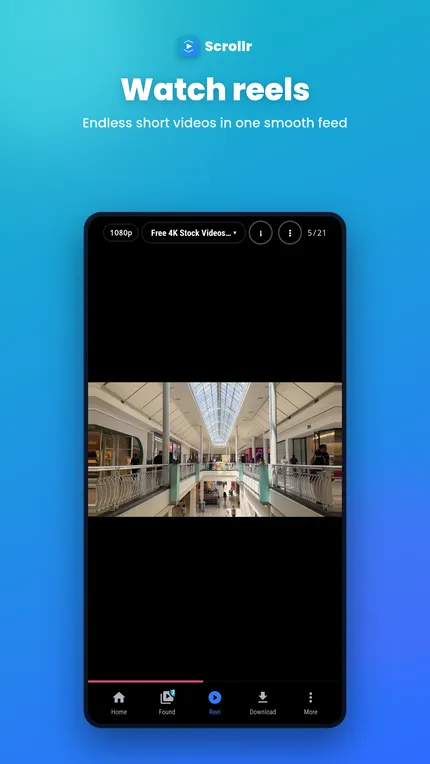
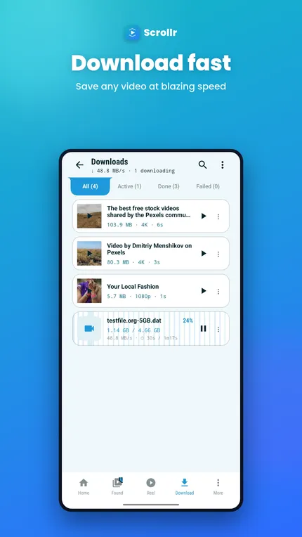
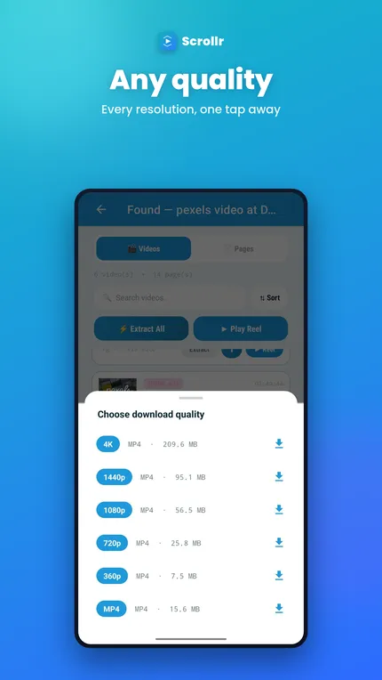
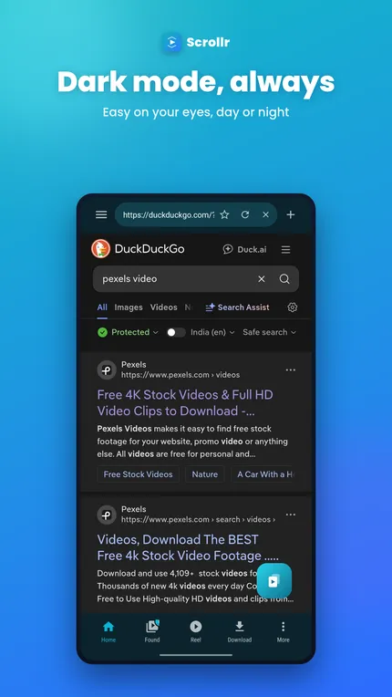
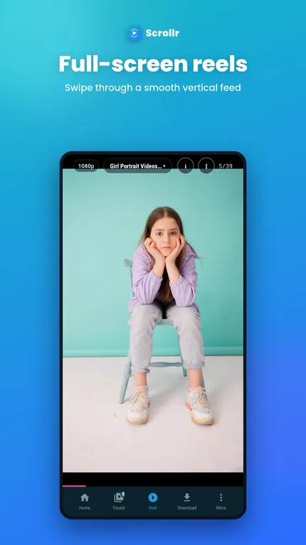
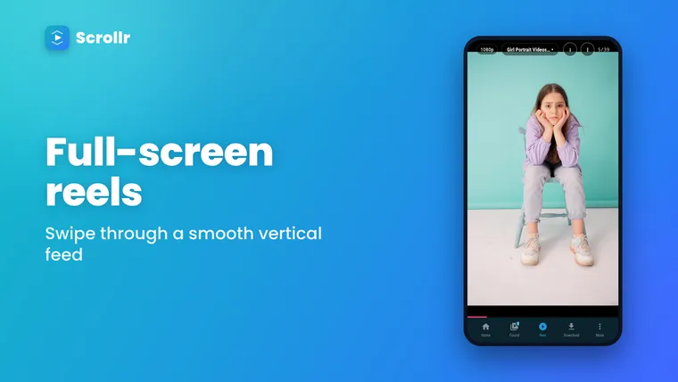
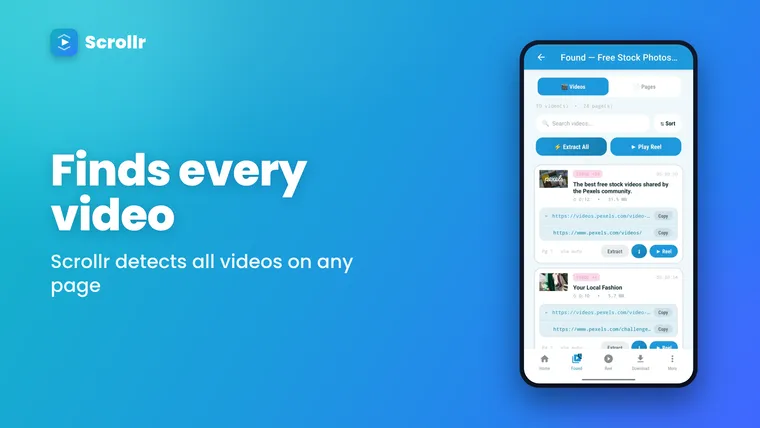

# Scrollr

**A video-first Android browser.** Browse any site, find every video on the page,
watch them as a swipeable reel, and download what you want.

---

## Scrollr is in closed testing

The app isn't public yet. To install it you have to be on the tester list, and
**joining the Google Group is what puts you on it.**

> ### Two steps, in this order
>
> **1 — Join the group:** <https://groups.google.com/g/mylovelytesters>
> Click **Join group**, using the same Google account your phone's Play Store uses.
>
> **2 — Then open Play:** <https://play.google.com/store/apps/details?id=com.scrollr>
> Install as normal.

If Play says the app isn't available, it's almost always one of these:

| What you see | What it means |
|---|---|
| "Item not found" / 404 | You opened the Play link before joining the group |
| Play is on a different account | Switch to the account that joined the group |
| Still missing after joining | Google can take a while to sync — give it a few hours |

---

## A look at it

---

## What's new

- **Whole anime series in a few taps** — episodes grouped under their show; pick all, a range
  or a few, and they download one after another, with both soundtracks and subtitles
- **A real offline player** — options grouped by Playback, Screen, Audio and Subtitle,
  top buttons you arrange yourself, subtitles you can restyle while the video plays
- **Your library, organised** — watched and resume marks, sorting, a date filter and folders
- **Faster, steadier stream downloads**, controllable from the notification
- **Help & feedback** in the More menu, with an optional screenshot

---

## What it does

Most browsers treat video as just another element on the page. Scrollr treats it as
the point.

### Finds every video, by itself
Pages are scanned as you browse and anything playable lands in **Found** — kept per tab,
so results from different sites never mix. Streams a page hides behind its own player get
resolved too — Scrollr reads how a site's player is put together (its configuration, the
player it embeds, the address its play button builds), so new sites work without being
taught one by one, and every quality a site offers is listed with its real size.
**Extract All** sweeps a whole listing page at once, and a floating button catches media
the page loads quietly in the background.

### Whole series, not just single videos
On an anime or series site, **Found** groups the episodes under their show — one card per
series, each episode listed once, however many times the site posted it. Tap the ones you
want, **Select all**, or give a **range**, choose a quality, and they are all queued at once
and downloaded one after another — with the screen off or the app in the background.

When a site has both, the Japanese soundtrack and the English dub are saved **in the same
file**, and a dub recorded at a slightly different speed is re-timed so it stays in step
with the picture. Subtitles are saved beside the video.

### Watch them as a reel

**Reel** turns a tab's finds into a full-screen vertical feed that buffers ahead, so
swiping is instant.

- **Hold anywhere** for 2× speed — release to go back to normal
- **Double-tap** either side to jump — 10 seconds by default, or your own amount and
  direction in **Settings ▸ Player controls**
- **Skip watched** hides anything you've already seen
- **Shuffle all tabs** mixes every tab's finds into one feed
- **Quality**: Auto, High (1080p), Standard (720p) or Data saver — a ceiling, never a
  demand, so a video that only exists in 4K still plays on Data saver

 

### Download fast, watch offline
Save direct MP4, HLS and DASH streams, choosing the resolution when a video offers
several. The downloader splits each file across **up to 32 parallel parts**, so large
videos come down quickly, and it keeps going in the background. Streams are fetched several
pieces at a time, a stalled piece is retried rather than holding up the rest, and the
finished stream is turned into a standard MP4 in seconds.

The notification shows every download and lets you **pause all, start all or exit**, or
pause and cancel one; a download that cannot continue says so there, with **Retry**. Each
file's details show its **resolution, size and average download speed**.

Your downloads then get **their own vertical reel** — everything you've saved is
watchable the same way, with no other app involved.

Something you already have is recognised before it downloads again, and you choose: a second
copy, a different name, or replacing the old file. A link that expired while it waited its
turn in the queue is refreshed and retried instead of failing, and a site that answers a
download with an error page has that refused rather than saved as a video. The list filters
by **size** — B, KB, MB or GB — as well as by state, and every video on the **Found** screen
shows whether it is saved, downloading or failed, with its size and speed.

### Your library
Downloads show at a glance what you have watched: a **✓ Watched** mark (80% counts — nobody
sits through the credits), or a bar on the thumbnail with how far you got. Sort by newest,
oldest, name or size, filter by date, and gather episodes into **folders** — reorder them by
dragging, and a folder's play button starts at the first episode you haven't finished.

### A player that plays everything
Saved videos open in Scrollr's own player, which plays almost any format and codec — MKV,
MP4, HEVC, multi-soundtrack files — and picks up where you left off, even after the phone
restarts.

- **One options panel**, grouped into Playback, Screen, Audio and Subtitle — a column down
  the side in landscape, the lower half of the screen in portrait
- **Top buttons you choose**: tap ✎, tap any option to put it beside Back, hold one to
  drag it into place
- **Swipes**: brightness on the left, volume on the right (up to **200%**), with the top and
  bottom edges left free for the phone's own swipes. In Reel mode, up and down changes video —
  with brightness and volume kept at the edges, or anywhere; choosing a layout shows an
  animated guide of exactly where each swipe works
- **Hold for 2×**, double-tap to skip, speed from 0.25× to 4×
- **Subtitles** drawn by the player itself, so size, colour and background change instantly
  without interrupting the video; load your own file, or shift their timing
- **Soundtracks by name** — Japanese, English, Spanish, Urdu… — switched with one tap
- Audio sync, equalizer, aspect, rotation lock, pop-up (picture-in-picture) play, and a
  **hardware / software decoding** switch for the rare file the phone's video chip shows wrongly
- The status bar stays out of the way while you watch and comes back only with the controls

### Reads comics and galleries, not just video
**Reader** strips a gallery page down to the pages themselves — no ads, no overlays, nothing
to dismiss — and shows them one at a time, as a book, or as one continuous strip. It works
out a site's full-size page addresses from the thumbnails on its index, so you read the real
pages rather than the postage stamps, and **Next chapter** carries on without going back to
the site.

Whatever you are reading can be saved: **one PDF** of the whole chapter, in page order, or
the pages as **separate images**.

### Blocks ads properly
A full Adblock Plus / uBlock-style network engine, not just a host blocklist: resource
types, first vs. third party, exception rules and per-site scoping are all honoured. It
runs **114,000+ active rules** from EasyList, EasyPrivacy, AdGuard Mobile, Fanboy and
malware lists, and you can see exactly what's loaded under **Settings ▸ Ad-block filters**.

### Browse the way you want
- **Tabs**, with a separate incognito space that keeps nothing when you leave it
- **Search engine per mode** — 10 presets or any search URL you paste. Normal and
  incognito keep their own, so choosing Google for browsing doesn't drag it into incognito
- **Bookmarks and history**, swipe to delete with undo
- **Dark and light**, plus an AMOLED-black incognito look
- **A link on your clipboard** is offered as soon as you tap the address bar, and a pasted
  address opens straight away
- **Pop-ups handled sensibly**: a site's own new tabs open, ad windows are dropped, and
  anything else is held back with a bar saying where it wanted to go
- **Double-tap Home** to close the tab you're on (optional)
- Desktop site, HTTPS-only, find in page, clear on exit, quick tab switch

### Built for tablets too

---

## Privacy

- **No account, no sign-up, no analytics, no tracking, no telemetry.**
- Bookmarks, history, downloads and settings never leave your device.
- Incognito keeps a completely separate tab space and discards it on exit.
- Crash reports are written to a **local file** you can read under
  **Settings ▸ Crash log** — nothing is sent anywhere on its own.
- **Help & feedback** (in the More menu) sends a message only when you write one and tap
  Send, and shows you exactly what will go first.

---

## Requirements

| | |
|---|---|
| Android | 8.0 (Oreo) or newer |
| Device | 64-bit (arm64) — effectively every phone since ~2019 |
| Size | ~80 MB installed |

---

## Found a bug?

[Open an issue](https://github.com/HelpersforEverybody/scrollr/issues) with:

1. What you did, and what happened instead
2. Your Android version and phone model
3. **If it crashed:** open **Settings ▸ Crash log**, tap **Copy all**, and paste it in —
   that one step turns a guess into a fix

Feedback and feature requests are welcome in the
[testers group](https://groups.google.com/g/mylovelytesters) too — or straight from the app, under
**More ▸ Help & feedback**.

---

**[Join the group](https://groups.google.com/g/mylovelytesters)** → **[Install from Play](https://play.google.com/store/apps/details?id=com.scrollr)**

This repository is the app's home page and issue tracker. The source code isn't published here.

